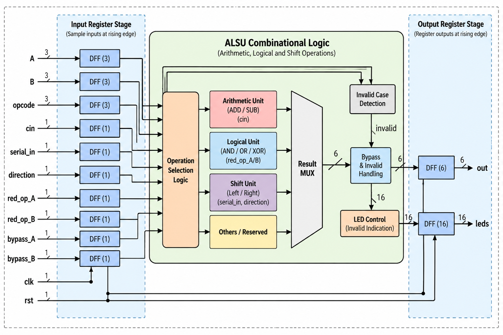
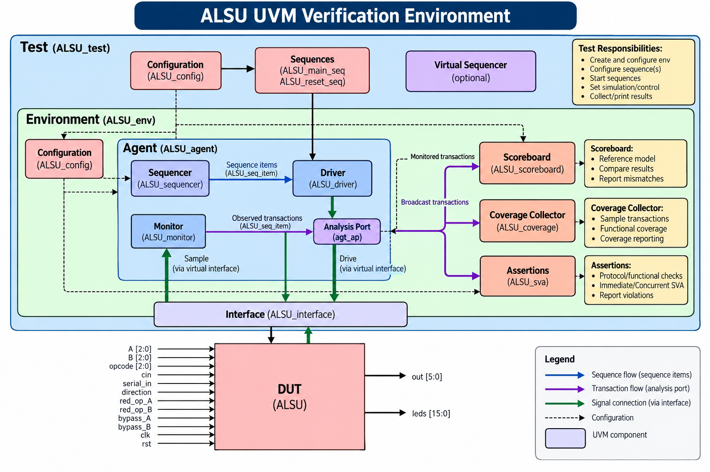
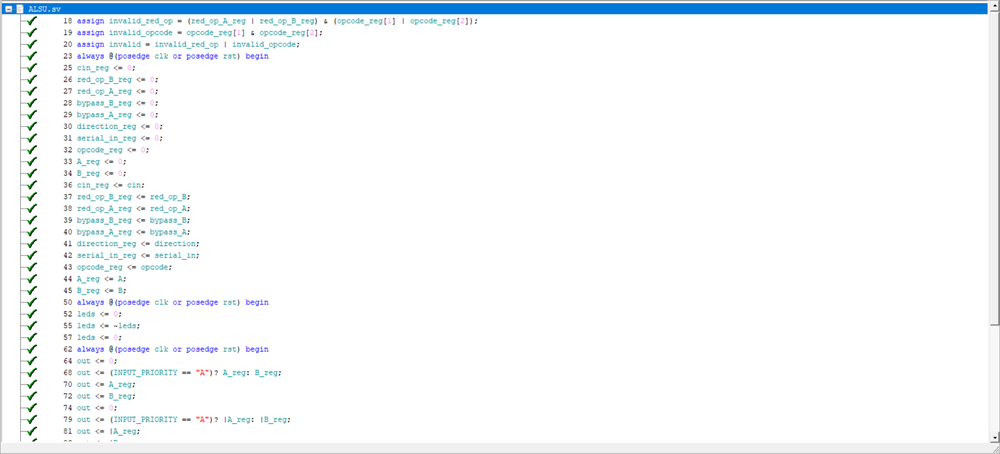
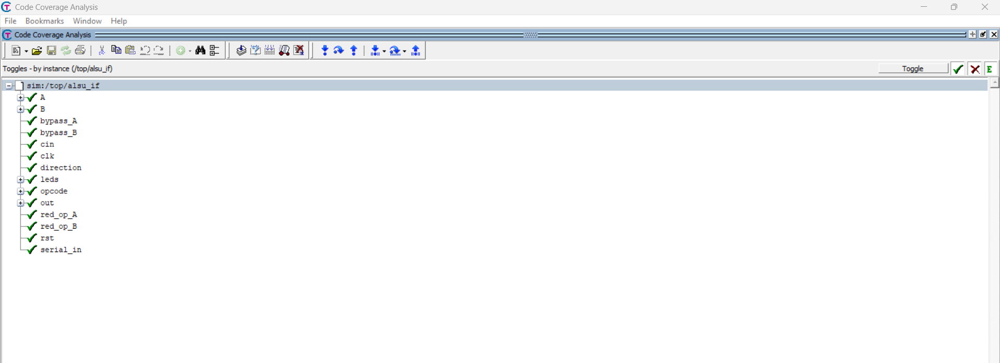
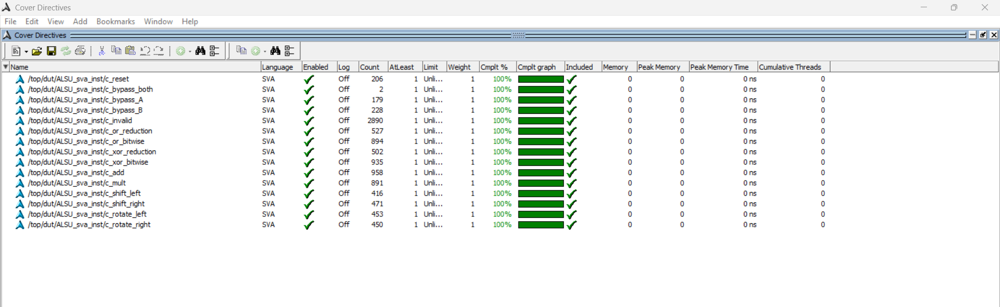
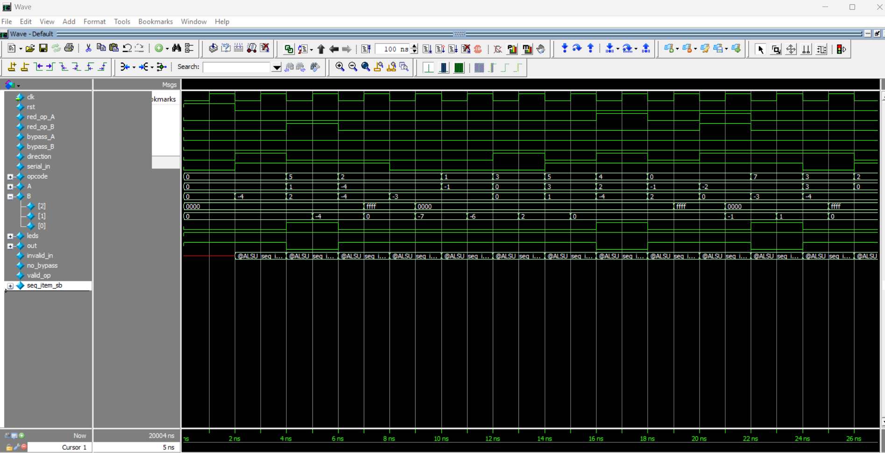

# ALSU RTL Design & UVM-Based Functional Verification

A SystemVerilog implementation and UVM verification environment for a **3-bit Arithmetic, Logic, and Shift Unit (ALSU)** with a **6-bit registered result** and **16-bit invalid-operation LED indicator**. The project exercises constrained-random stimulus, a self-checking reference model, functional coverage, SystemVerilog Assertions (SVA), and QuestaSim coverage analysis.

## Project overview

The ALSU accepts signed 3-bit operands `A` and `B` and performs six operations selected by a 3-bit opcode. All functional inputs are registered at the rising clock edge; the result and LED indicators are also registered. The RTL supports operand bypass, reduction operations for OR/XOR, invalid-operation detection, and parameter-controlled priorities.

| Opcode | Operation | Behavior |
|:---:|---|---|
| `000` | OR | Bitwise OR, or reduction OR when selected |
| `001` | XOR | Bitwise XOR, or reduction XOR when selected |
| `010` | ADD | Signed addition, with optional carry-in |
| `011` | MULT | Signed multiplication |
| `100` | SHIFT | Shift the previous 6-bit output left/right with `serial_in` |
| `101` | ROTATE | Rotate the previous 6-bit output left/right |
| `110`, `111` | Invalid | Output zero unless bypass takes priority; LED indicator toggles |

**RTL parameters:** `INPUT_PRIORITY = "A"` chooses the winner if both bypass inputs (or both reduction inputs) are asserted; `FULL_ADDER = "ON"` includes `cin` in addition. The verification test targets the default parameter configuration.

### Interface

- **Inputs:** `A[2:0]`, `B[2:0]`, `opcode[2:0]`, `cin`, `serial_in`, `direction`, `red_op_A`, `red_op_B`, `bypass_A`, `bypass_B`, `clk`, and active-high asynchronous `rst`.
- **Outputs:** signed `out[5:0]` and `leds[15:0]`.
- **Invalid cases:** unsupported opcodes 6/7 or asserted reduction controls with operations other than OR/XOR. Bypass has priority over invalid-result handling; the LED indication still follows the invalid condition.

## Design architecture

The input registers capture the operands and controls on one rising edge; the output registers update from the previously captured values on a subsequent rising edge. This latency must be considered when checking input/output pairs.



## UVM verification architecture

The test runs a reset sequence followed by a constrained-random main sequence. The active agent contains a sequencer, driver, and monitor. The monitor publishes observed transactions through an analysis port, and the environment connects that port **independently** to both the scoreboard and the functional coverage collector.



| Component | Responsibility |
|---|---|
| `ALSU_test` | Configure environment and run reset/main sequences |
| `ALSU_seq_item` | Represent stimulus and observed ALSU transactions |
| `ALSU_sequencer` | Supply sequence items to the driver |
| `ALSU_driver` | Drive ALSU interface inputs |
| `ALSU_monitor` | Sample interface signals and publish transactions |
| `ALSU_scoreboard` | Calculate expected results using a stateful reference model; compare `out` and `leds` |
| `ALSU_coverage` | Sample functional coverpoints and crosses from monitored transactions |
| `ALSU_sva` | Check timing-dependent design properties with assertions |

### Verification strategy

The assignment-driven constrained-random stimulus emphasizes:

1. Reset assertion at low probability.
2. `ZERO`, `MAXPOS`, and `MAXNEG` operand values for ADD and MULT.
3. Walking-one patterns with reduction OR/XOR, including opposite-operand zero cases.
4. Less frequent invalid opcodes and invalid reduction combinations.
5. Mostly disabled bypass controls, while still exercising bypass priority.
6. Unconstrained operands during SHIFT and ROTATE.

The **scoreboard** models registered-input latency and maintains state for SHIFT/ROTATE, then compares predicted and observed `out`/`leds` using four-state inequality (`!==`). The **coverage collector** separately tracks opcode values, arithmetic operand crosses, carry-in, shift/rotate direction, serial input, reduction patterns, invalid reductions, bypass priority, and reset.

**Verification caution:** a passing scoreboard summary is not, by itself, proof of race-free sampling. Driver/monitor edge scheduling and reference-model alignment should be checked with deterministic cycle-by-cycle tests and deliberate fault injection before claiming complete verification closure.

## Assertions and coverage

The bound SVA module checks reset, bypass behavior, invalid-result handling, arithmetic and logical operations, and other temporal properties. The simulation script enables code coverage and saves a UCDB database for review.

### Simulation evidence

Add your actual QuestaSim screenshots below. Only publish numeric coverage percentages and pass/fail counts taken directly from the simulation reports.

| Evidence | Screenshot |
|---|---|
| Functional coverage |  |
| Statement coverage |  |
| Toggle coverage |  |
| Assertion coverage |  |
| Waveforms |  |

## Running the simulation

**Simulator:** Siemens QuestaSim / Questa supporting SystemVerilog and UVM.

From the directory containing `run.do` and `src_files.list`, run:

```tcl
vsim -do run.do
```

The script compiles the source list, starts `work.top`, enables coverage, adds waveforms, runs the simulation, and saves `ALSU.ucdb` on exit. If you reorganize the source tree into `rtl/`, `tb/`, and `sim/`, update relative paths in `src_files.list` and `run.do` first.

## Repository files

- `ALSU.sv` — RTL implementation
- `ALSU_interface.sv` — shared DUT/verification interface
- `ALSU_pkg.sv` — operation definitions and constants
- `ALSU_*seq*.sv` — sequence item and stimulus sequences
- `ALSU_driver.sv`, `ALSU_monitor.sv`, `ALSU_agent.sv` — active UVM agent
- `ALSU_env.sv`, `ALSU_test.sv`, `ALSU_config.sv` — environment, test, configuration
- `ALSU_scoreboard.sv` — reference model and result checker
- `ALSU_coverage.sv` — functional coverage collector
- `ALSU_sva.sv` — assertions
- `top.sv` — top-level simulation module
- `src_files.list`, `run.do` — compilation and simulation setup

## Skills demonstrated

**SystemVerilog RTL · UVM · Constrained-Random Verification · Reference Modeling · Scoreboarding · Functional Coverage · SVA · QuestaSim · Debugging**

> Based on the ALSU design and verification requirements in *Data Types & Constrained Random Assignment*, question 3. Coverage and bug-fix claims should be supported by the attached reports and simulation evidence.
