# Asynchronous FIFO — Design and UVM Verification

An asynchronous (dual-clock) FIFO in Verilog, verified with a UVM testbench in SystemVerilog.
The DUT is compared cycle by cycle against a golden reference model, checked with SVA assertions, and measured with functional and code coverage in QuestaSim.

This README walks from the basic idea (a circular buffer) to the clock-domain-crossing design, and then through every part of the UVM testbench.

---

## Contents

1. [Repository structure](#1-repository-structure)
2. [The FIFO as a circular buffer](#2-the-fifo-as-a-circular-buffer)
3. [Why one extra pointer bit: full vs empty](#3-why-one-extra-pointer-bit-full-vs-empty)
4. [The asynchronous problem: two clocks](#4-the-asynchronous-problem-two-clocks)
5. [Gray code and the 2-flop synchronizer](#5-gray-code-and-the-2-flop-synchronizer)
6. [The design block by block](#6-the-design-block-by-block)
7. [Flag latency: pessimistic but safe](#7-flag-latency-pessimistic-but-safe)
8. [UVM testbench architecture](#8-uvm-testbench-architecture)
9. [Clocking blocks and timing](#9-clocking-blocks-and-timing)
10. [Testbench files one by one](#10-testbench-files-one-by-one)
11. [Assertions (SVA)](#11-assertions-sva)
12. [How to run](#12-how-to-run)
13. [Simulation results](#13-simulation-results)
14. [Known limitations](#14-known-limitations)

---

## 1. Repository structure

```
async-fifo-uvm/
├── rtl/                    Design under test
│   ├── ASYNC_FIFO.v        top-level async FIFO
│   ├── Binary2Gray.v       binary -> Gray converter
│   ├── Gray2Binary.v       Gray -> binary converter
│   └── Double_FF_Sync.v    2-flop synchronizer
├── golden/
│   └── ASYNC_FIFO_GOLD.v   independent reference model
├── sva/
│   └── FIFO_sva.sv         assertions, bound into the DUT
├── tb/                     UVM testbench
│   ├── FIFO_if.sv          interface, clocks, clocking blocks
│   ├── FIFO_pkg.sv         package that includes every class
│   ├── FIFO_config.sv
│   ├── FIFO_seq_item.sv
│   ├── FIFO_reset_sequence.sv
│   ├── FIFO_main_sequence.sv
│   ├── FIFO_sequencer.sv
│   ├── FIFO_driver.sv
│   ├── FIFO_monitor.sv
│   ├── FIFO_agent.sv
│   ├── FIFO_scoreboard.sv
│   ├── FIFO_coverage.sv
│   ├── FIFO_env.sv
│   ├── FIFO_test.sv
│   └── FIFO_top.sv
├── sim/
│   ├── run.do              QuestaSim script
│   ├── src_files.list      compile order
│   └── mem.dat             initial memory contents
├── reports/                coverage results
│   ├── FIFO_cov_report.txt     functional coverage (text)
│   ├── FIFO_sva_report.txt     assertions (text)
│   ├── functional_cov.png
│   ├── statement_cov.png
│   ├── branch_cov.png
│   ├── condition_cov.png
│   ├── expression_cov.png
│   ├── toggle_cov.png
│   └── assertions.png
└── docs/
    ├── images/             diagrams used in this README
    └── waveforms/          QuestaSim waveform snapshots
```

---

## 2. The FIFO as a circular buffer

A FIFO (first in, first out) stores data in the order it arrives and returns it in the same order.
Inside, it is a small memory used as a **ring**: a write pointer says where the next value goes, a read pointer says where the next value comes from, and both move forward and wrap around at the end.

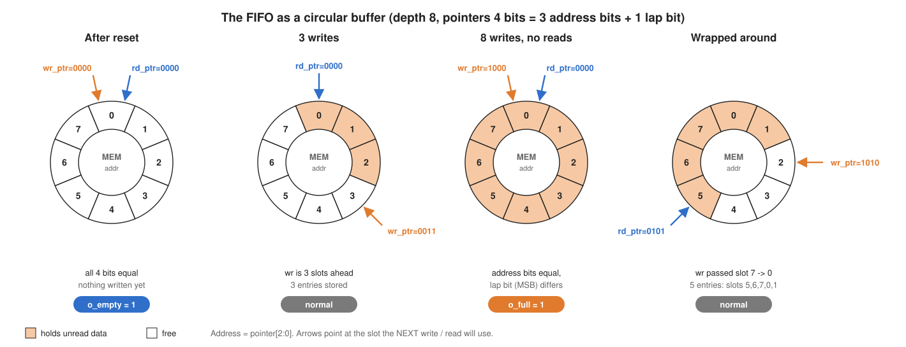

- **After reset** both pointers sit on slot 0. Nothing is stored, so the FIFO is empty.
- **Writing** stores `i_wdata` at `MEM[wr_ptr]` and moves the write pointer forward.
- **Reading** returns `MEM[rd_ptr]` on `o_rdata` and moves the read pointer forward.
- **Wrapping**: after slot 7 the pointer goes back to slot 0, so the memory is reused forever without moving any data.

This design has depth 8 and width 4 (`FIFO_DEPTH = 8`, `FIFO_WIDTH = 4`), so the memory is `MEM[0:7]` of 4-bit words.

---

## 3. Why one extra pointer bit: full vs empty

With only 3 address bits, "full" and "empty" look the same: in both cases the two pointers point at the same slot.
The design therefore makes the pointers **4 bits** (`[ADDR_WIDTH:0]`). The lower 3 bits are the address; the top bit counts laps.

| `wr_ptr` (hex) | binary | lap bit | address used |
|---|---|---|---|
| 0 … 7 | 0000 … 0111 | 0 | 0 … 7 (first lap) |
| 8 | 1000 | 1 | 0 (second lap) |
| 9 | 1001 | 1 | 1 |
| … | … | … | … |
| f → 0 | 1111 → 0000 | back to 0 | wraps |

Only reset brings a pointer back to 0. In a waveform you will see the pointers keep counting 8, 9, a, … after the first lap; that is expected.

| Condition | Rule | Example |
|---|---|---|
| **Empty** | all 4 bits equal | `rd = 1000`, `wr = 1000` |
| **Full** | address bits equal, lap bit different | `rd = 0000`, `wr = 1000` (writer one lap ahead) |

In the RTL:

```verilog
assign o_full  = (wr_ptr[ADDR_WIDTH] != rd_ptr_G2B[ADDR_WIDTH]) &&
                 (wr_ptr[ADDR_WIDTH-1:0] == rd_ptr_G2B[ADDR_WIDTH-1:0]);
assign o_empty = (rd_ptr == wr_ptr_G2B);
```

---

## 4. The asynchronous problem: two clocks

In an asynchronous FIFO the writer and reader run on **unrelated clocks** (`i_wclk` and `i_rclk`).

- `o_full` is needed by the **writer**, so it must be computed in the write domain. It needs the read pointer.
- `o_empty` is needed by the **reader**, so it must be computed in the read domain. It needs the write pointer.

So each pointer has to cross into the other clock domain. Sampling a multi-bit value that changes on a different clock causes two problems:

1. **Metastability**: a flop that samples a signal exactly while it changes can get stuck between 0 and 1 for a while before settling.
2. **Incoherent multi-bit values**: when a binary counter goes `0111 → 1000`, all four bits change. If they are sampled mid-change, the other side might see `1111` or `0000` — a value the counter never had.

---

## 5. Gray code and the 2-flop synchronizer

The design solves both problems together:

**Gray code** — consecutive values differ in exactly one bit:

| binary | 0000 | 0001 | 0010 | 0011 | 0100 | 0101 | 0110 | 0111 | 1000 |
|---|---|---|---|---|---|---|---|---|---|
| Gray | 0000 | 0001 | 0011 | 0010 | 0110 | 0111 | 0101 | 0100 | 1100 |

If the other domain samples a Gray pointer while it changes, only one bit is uncertain, so it sees either the old value or the new one — never garbage.

- `Binary2Gray.v`: `gray[i] = bin[i+1] ^ bin[i]`, MSB copied (equivalently `bin ^ (bin >> 1)`).
- `Gray2Binary.v`: `bin[MSB] = gray[MSB]`, then `bin[i] = gray[i] ^ bin[i+1]` working down.

**2-flop synchronizer** (`Double_FF_Sync.v`) — two flip-flops in series, clocked by the *receiving* clock. If the first flop goes metastable, it has a whole clock cycle to settle before the second flop samples it.

```verilog
data_FF1 <= i_data;
data_FF2 <= data_FF1;   // non-blocking: FF2 gets the OLD FF1, so data moves one stage per clock
```

---

## 6. The design block by block

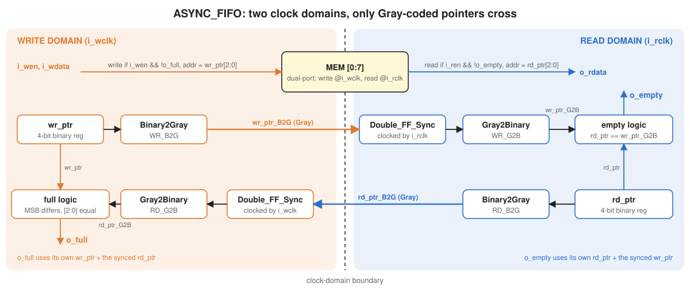

| Block | Domain | Purpose |
|---|---|---|
| `MEM[0:7]` | written on `i_wclk`, read on `i_rclk` | the storage |
| `wr_ptr` | write | 4-bit binary write pointer, `+1` on every accepted write (`i_wen && !o_full`) |
| `WR_B2G` → `WR_DFF_SYNCH` → `WR_G2B` | write → read | sends the write pointer to the read side as `wr_ptr_G2B` |
| `rd_ptr` | read | 4-bit binary read pointer, `+1` on every accepted read (`i_ren && !o_empty`) |
| `RD_B2G` → `RD_DFF_SYNCH` → `RD_G2B` | read → write | sends the read pointer to the write side as `rd_ptr_G2B` |
| full logic | write | `wr_ptr` vs synchronized `rd_ptr_G2B` |
| empty logic | read | `rd_ptr` vs synchronized `wr_ptr_G2B` |

Writes while full and reads while empty are ignored: the pointer does not move and memory is untouched. `o_rdata` is registered and keeps its last value when no read happens.

---

## 7. Flag latency: pessimistic but safe

A pointer change needs two edges of the *other* clock to arrive. With `i_wclk` period 20 and `i_rclk` period 10:

```
t      write at posedge i_wclk       -> wr_ptr 8 -> 9
t+5    posedge i_rclk                -> FF1 captures Gray(9)
t+15   posedge i_rclk                -> FF2 -> wr_ptr_G2B = 9 -> o_empty falls
```

So for a short time:

- `o_empty` stays high after a write → the reader waits a little longer than needed.
- `o_full` stays high after a read → the writer waits a little longer than needed.

The flags can be **late, never wrong**: the FIFO never reads an empty slot and never overwrites unread data.
Each flag still updates **immediately** after an action on its own side (a read that empties the FIFO raises `o_empty` at that same read edge).

---

## 8. UVM testbench architecture

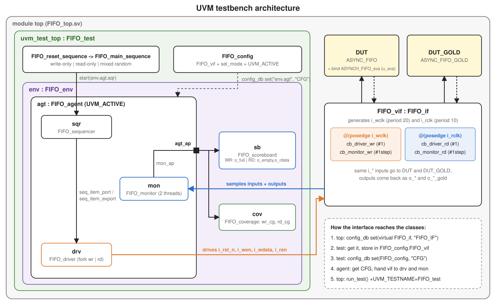

The data flow:

```
sequence -> sequencer -> driver -> interface -> DUT + golden model -> interface -> monitor -> scoreboard + coverage
```

- The **same inputs** drive both the DUT (`ASYNC_FIFO`) and the golden model (`ASYNC_FIFO_GOLD`).
- Their outputs come back on the interface as `o_*` and `o_*_gold`.
- The **scoreboard** compares them; the **coverage** collector records which scenarios were exercised; the **SVA** module checks internal rules directly inside the DUT.

### How the virtual interface reaches the classes

1. `FIFO_top` sets `virtual FIFO_if` in the `uvm_config_db` under `"FIFO_IF"`.
2. `FIFO_test` gets it and stores it in a `FIFO_config` object (`FIFO_vif`, `sel_mode = UVM_ACTIVE`).
3. The test sets that config for `"env.agt"` under `"CFG"`.
4. `FIFO_agent` gets `CFG` and hands the interface to the driver and monitor in `connect_phase`.

---

## 9. Clocking blocks and timing

The interface defines four clocking blocks — two per clock:

| Clocking block | Event | Direction (testbench view) | Signals |
|---|---|---|---|
| `cb_driver_wr` | `posedge i_wclk` | `output #1` | `i_rst_n, i_wen, i_wdata` |
| `cb_driver_rd` | `posedge i_rclk` | `output #1` | `i_ren` |
| `cb_monitor_wr` | `posedge i_wclk` | `input #1step` | `i_rst_n, i_wen, i_wdata, o_full, o_full_gold` |
| `cb_monitor_rd` | `posedge i_rclk` | `input #1step` | `i_rst_n, i_ren, o_empty, o_rdata, o_empty_gold, o_rdata_gold` |

Directions are from the **testbench's** point of view: the driver *writes* (`output`), the monitor only *reads* (`input`).
A clocking block does not create a clock — it follows an existing one. `@(FIFO_vif.cb_driver_wr)` simply waits for `posedge i_wclk`.

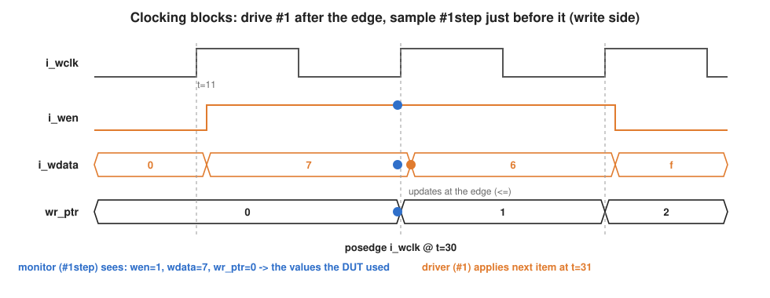

- **Driver, `#1`**: new values appear 1 time unit *after* the edge, so they are stable long before the next edge where the DUT samples them.
- **Monitor, `#1step`**: values are taken from *just before* the edge — exactly what the DUT used to make its decision at that edge. It is not a real delay and not a setup-time window: simulation time is discrete, and `#1step` means "the value at the end of the previous time step".
- **DUT registers (`<=`)** change *at* the edge in the waveform. Non-blocking assignment does not add time; it only orders the update after all flops have read their inputs.

Why clocking blocks matter here: the two clocks are unrelated, so their edges can coincide. `#1step` sampling and skewed driving keep each domain race-free whatever the clock ratio, and each signal is tied to its own clock.

---

## 10. Testbench files one by one

### `FIFO_if.sv` — interface
Holds the stimulus signals, DUT outputs and golden outputs. Generates the clocks (`i_wclk` period 20, `i_rclk` period 10) and declares the four clocking blocks above.

### `FIFO_pkg.sv` — package
Defines `FIFO_WIDTH`, `FIFO_DEPTH`, `ADDR_WIDTH` and `TESTS` (10 000), imports UVM, and `` `include ``s every class in dependency order.

### `FIFO_config.sv` — configuration object
Carries the virtual interface and the active/passive mode from the test down to the agent.

### `FIFO_seq_item.sv` — transaction
- Random stimulus: `i_rst_n`, `i_wen`, `i_wdata`, `i_ren`.
- Observed outputs: DUT `o_full/o_empty/o_rdata` and golden `o_*_gold`.
- `side` (`WR_SIDE` / `RD_SIDE`): which clock domain the monitor sampled it in.
- Constraints: reset 2 %, `i_wen` high 70 %, `i_ren` high 30 %, plus `write_only` and `read_only` modes. Those two contradict each other, so they are **off by default** and sequences switch on the one they need.

### `FIFO_reset_sequence.sv`
One item with reset asserted and all enables low.

### `FIFO_main_sequence.sv`
Three phases, a new item every loop:

| Phase | Items | Purpose |
|---|---|---|
| Write only | `TESTS/2` | fill the FIFO, then keep writing while full (overflow attempts) |
| Read only | `TESTS/4` | drain it, then keep reading while empty (underflow attempts) |
| Mixed random | `TESTS/4` | default distributions, real traffic in both directions |

### `FIFO_sequencer.sv`
Standard `uvm_sequencer #(FIFO_seq_item)`; arbitrates and passes items to the driver.

### `FIFO_driver.sv`
For each item it forks the two domains:

```systemverilog
fork
  begin  @(FIFO_vif.cb_driver_wr);  // write domain
         FIFO_vif.cb_driver_wr.i_rst_n <= ...; i_wen <= ...; i_wdata <= ...;
  end
  begin  @(FIFO_vif.cb_driver_rd);  // read domain
         FIFO_vif.cb_driver_rd.i_ren <= ...;
  end
join
```

`item_done()` is called when both domains have taken the item, so each item lasts one `i_wclk` period. Because `i_rclk` is twice as fast, `i_ren` stays applied for about two read cycles per item.

### `FIFO_monitor.sv`
Two threads, one per clocking block. Every rising edge of each clock produces one item tagged with its `side`, written to the analysis port `mon_ap`.

### `FIFO_agent.sv`
Builds sequencer and driver only in `UVM_ACTIVE` mode, the monitor always. Connects `drv.seq_item_port` to `sqr.seq_item_export` and forwards `mon_ap` to `agt_ap`.

### `FIFO_scoreboard.sv`
Compares DUT against golden model, each output only in the domain that produces it:

| Item side | Checked |
|---|---|
| `WR_SIDE` | `o_full === o_full_gold` |
| `RD_SIDE` | `o_empty === o_empty_gold` and `o_rdata === o_rdata_gold` |

Mismatches raise `uvm_error` with the full transaction. Totals are printed in `report_phase`.

Because the monitor samples *before* the edge, an item shows the state the DUT used, not the result of that edge (a read at time *t* shows its new `o_rdata` in the next read-side sample). Both models are sampled at the same moment, so any difference is a real bug.

### `FIFO_coverage.sv`
One covergroup per domain, ignored while reset is active:

| Covergroup | Coverpoints |
|---|---|
| `wr_cg` | `i_wen`; `o_full`; `o_full` rising/falling; every `i_wdata` value actually written; cross `i_wen × o_full` (includes *write while full*) |
| `rd_cg` | `i_ren`; `o_empty`; `o_empty` rising/falling; cross `i_ren × o_empty` (includes *read while empty*) |

### `FIFO_env.sv`
Builds agent, scoreboard and coverage, and connects `agt_ap` to both subscribers.

### `FIFO_test.sv`
Builds env and config, publishes the config, then runs reset followed by the main sequence. Waits `#100` before dropping the objection so the last samples reach the scoreboard.

### `FIFO_top.sv`
Instantiates the interface, the DUT and the golden model on the same signals, binds `ASYNCH_FIFO_sva` into every `ASYNC_FIFO`, loads `mem.dat` into `DUT.MEM`, sets the interface in the config DB and calls `run_test()`.

---

## 11. Assertions (SVA)

`sva/FIFO_sva.sv` is bound into the DUT with `bind ASYNC_FIFO ASYNCH_FIFO_sva ... u_sva (.*)`, so it can see internal pointers.

| Assertion | Clock | Checks |
|---|---|---|
| `RST_ASSERTION` | immediate (`assert final`) | during reset: not full, empty, both pointers 0 |
| `full_cond_assertion` | `i_wclk` | `o_full` equals the full rule |
| `empty_cond_assertion` | `i_rclk` | `o_empty` equals the empty rule |
| `wr_ptr_cond_assertion` | `i_wclk` | accepted write → `wr_ptr` +1 next cycle |
| `rd_ptr_cond_assertion` | `i_rclk` | accepted read → `rd_ptr` +1 next cycle |

Matching `cover property` statements confirm each scenario actually happened (full rising, empty rising, pointer increments).

---

## 12. How to run

Tested flow: **QuestaSim** with its built-in UVM library.

```
cd sim
vsim -do run.do
```

or open QuestaSim in `sim/` and type `do run.do`.

`run.do` compiles everything listed in `src_files.list` (with `-sv`, because `ASYNC_FIFO.v` uses a `localparam` in its parameter list), runs `FIFO_test`, adds the interface and SVA signals to the wave window, and writes into [`reports/`](reports):

| File | Content |
|---|---|
| `FIFO_cov_report.txt` | functional coverage (covergroups) |
| `FIFO_sva_report.txt` | assertion pass/fail and cover hits |
| `FIFO_code_cov_report.txt` | code coverage of the DUT |
| `FIFO_cov.ucdb` | coverage database (`vsim -viewcov FIFO_cov.ucdb`) |

A clean run ends with `Total failed checks: 0` from the scoreboard and no assertion failures.

---

## 13. Simulation results

### 13.1 Write only, until full

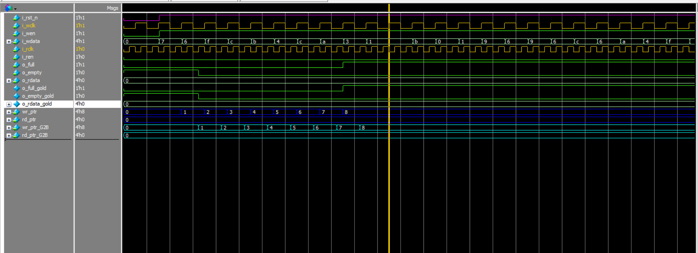

What to look for:

- After reset, `i_wen = 1`, `i_ren = 0`. Each `i_wclk` rising edge writes `i_wdata` into `MEM[wr_ptr[2:0]]` and `wr_ptr` counts `0 → 1 → … → 8`.
- `wr_ptr_G2B` follows `wr_ptr` two `i_rclk` edges later, and `o_empty` falls after the first write reaches the read side.
- When `wr_ptr = 1000` and `rd_ptr_G2B = 0000` (address bits equal, lap bit different) `o_full` rises.
- While `o_full = 1` the remaining writes are **blocked**: `wr_ptr` stays at 8 even though `i_wen` is still high.
- `o_full_gold` and `o_empty_gold` change on exactly the same edges as the DUT.

### 13.2 Read only, until empty

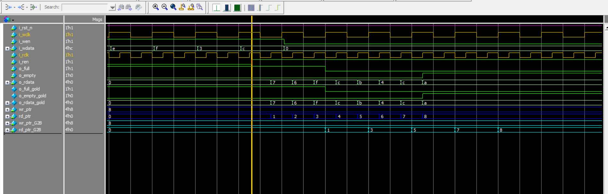

What to look for:

- `i_wen = 0`, `i_ren = 1`. Each accepted `i_rclk` edge puts `MEM[rd_ptr[2:0]]` on `o_rdata`, and `rd_ptr` counts `0 → … → 8`.
- `o_rdata` returns the eight values **in the same order** they were written in 13.1.
- `rd_ptr_G2B` reaches the write side two `i_wclk` edges after each read, so `o_full` falls a little after the first read.
- When `rd_ptr == wr_ptr_G2B` `o_empty` rises **at that read edge**, and the remaining reads are **blocked**: `rd_ptr` stops and `o_rdata` keeps its last value.
- `o_rdata_gold` matches `o_rdata` on every read.

### 13.3 Mixed reads and writes

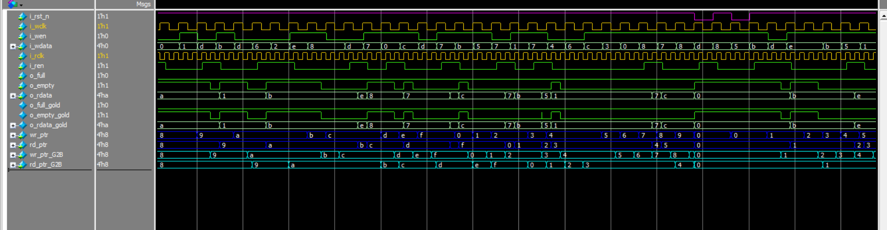

What to look for:

- Writes and reads interleave in their own clock domains; the FIFO stays mostly near empty because the read clock is twice as fast.
- After a write, `o_empty` drops only once `wr_ptr_G2B` catches up (two `i_rclk` edges): the flag is late but never wrong.
- A read right after `o_empty` falls returns the value that was just written, then `o_empty` rises again on the same edge.
- The pointers keep counting past `8` (`9, a, …`) — the lap bit, not a bug.

### 13.4 Scoreboard

The scoreboard prints at the end of the run:

```
UVM_INFO ... [report_phase] Total successful checks: <N>
UVM_INFO ... [report_phase] Total failed checks: 0
```

### 13.5 Functional coverage

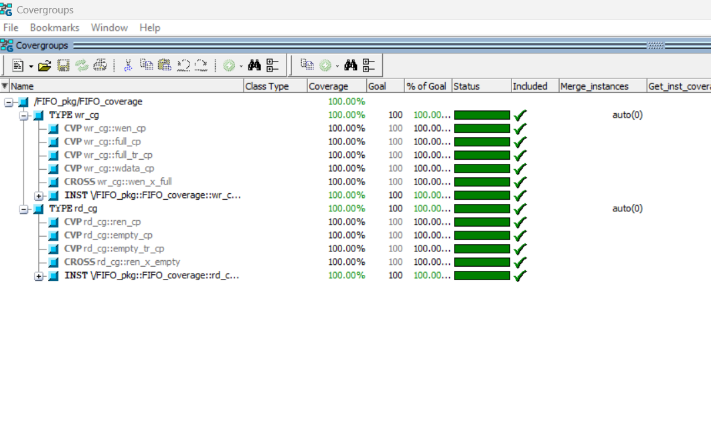

Functional coverage answers *"did we test every scenario in the plan?"* It comes from the two covergroups in `FIFO_coverage.sv`:

| Covergroup | What its bins prove was exercised |
|---|---|
| `wr_cg` | writes and idle cycles; FIFO full and not full; `o_full` rising **and** falling; every 4-bit value written (0 … f); **write while full** (`i_wen × o_full` cross) |
| `rd_cg` | reads and idle cycles; FIFO empty and not empty; `o_empty` rising **and** falling; **read while empty** (`i_ren × o_empty` cross) |

Full text report: [`FIFO_cov_report.txt`](reports/FIFO_cov_report.txt)

---

### 13.6 Code coverage

Code coverage answers *"did the stimulus reach every part of the RTL?"* It is collected on `ASYNC_FIFO` and its sub-modules (`Binary2Gray`, `Gray2Binary`, `Double_FF_Sync`).

#### Statement coverage

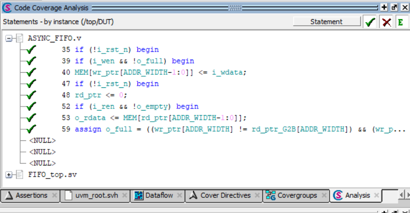

Every executable line ran at least once: the reset assignments, the memory write and `wr_ptr` increment, the memory read and `rd_ptr` increment, the synchronizer flops and the Gray converters.

#### Branch coverage

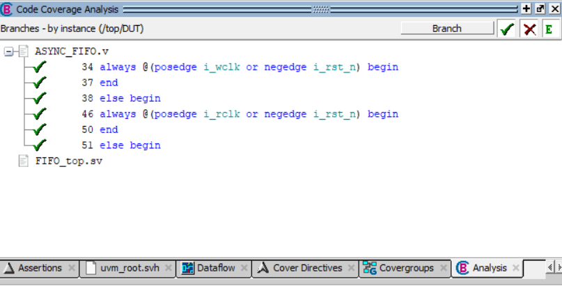

Every `if / else` and `? :` took **both** directions:

- `if (!i_rst_n)` — reset and normal operation.
- `if (i_wen && !o_full)` — write accepted and write not done (idle **or** blocked by full).
- `if (i_ren && !o_empty)` — read accepted and read not done (idle **or** blocked by empty).
- `o_full = (...) ? 1 : 0` and `o_empty = (...) ? 1 : 0` — each flag both set and cleared.

#### Condition coverage

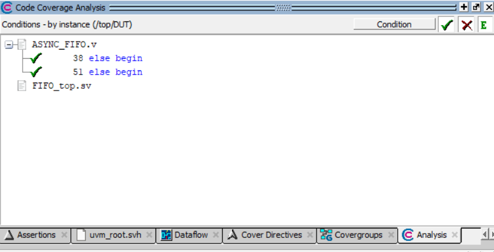

For each `if` with more than one input, every input was shown to change the decision on its own:

| Condition | Needs |
|---|---|
| `i_wen && !o_full` | `i_wen = 0` (no write), `i_wen = 1 & o_full = 0` (write), `i_wen = 1 & o_full = 1` (**write while full**) |
| `i_ren && !o_empty` | `i_ren = 0` (no read), `i_ren = 1 & o_empty = 0` (read), `i_ren = 1 & o_empty = 1` (**read while empty**) |

This is why the write-only and read-only phases deliberately keep going past full and past empty.

#### Expression coverage

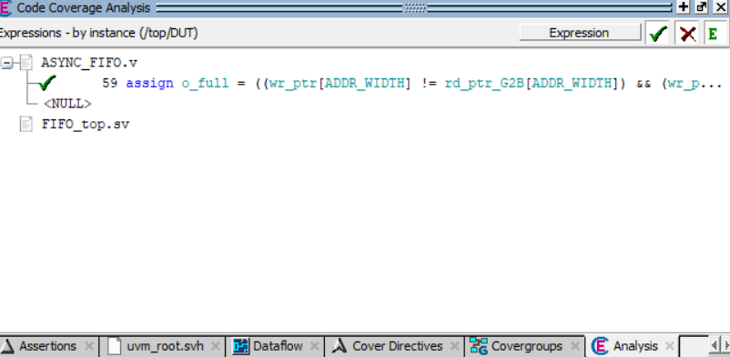

Same idea as condition coverage, applied to the continuous assignments:

- `o_full`: the lap-bit term (`wr_ptr[3] != rd_ptr_G2B[3]`) and the address term (`wr_ptr[2:0] == rd_ptr_G2B[2:0]`) each decided the result — e.g. equal addresses on the **same** lap (empty, not full) vs on **different** laps (full).
- `o_empty`: `rd_ptr == wr_ptr_G2B` both true and false.
- The XOR expressions inside `Binary2Gray` / `Gray2Binary`.

#### Toggle coverage


Every bit of every signal went `0 → 1` **and** `1 → 0`: the data buses, the flags, all four bits of both pointers (the lap bit only toggles after the FIFO has gone round at least once, and back to 0 after two laps), their Gray versions, and both stages of each synchronizer.

---

### 13.7 Assertions

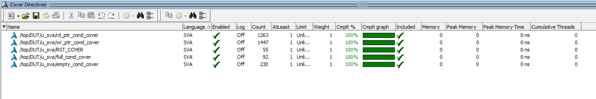

Pass and failure counts for every SVA assertion from [section 11](#11-assertions-sva), plus the hit count of every `cover property`. The cover hits matter: they show the scenarios really happened, so the assertions did not pass vacuously.

Full text report: [`FIFO_sva_report.txt`](reports/FIFO_sva_report.txt)

---

## 14. Known limitations

- **Golden model parameters**: `ASYNC_FIFO_GOLD` hard-codes 4-bit `bin2gray`/`gray2bin` tables and sizes its synchronizers with `DATA_WIDTH`. It is only valid for depth 8 and width 4; changing the package parameters will produce false mismatches.
- **RTL simulation has no metastability**: the synchronizers simply delay values by two clean cycles. Proving the clock crossing safe is the job of CDC tools and timing analysis, not of this testbench.
- **Stimulus balance**: the write-only phase (`TESTS/2` items) fills the FIFO after 8 writes, so most of those items are blocked writes. Real mixed traffic comes from the third phase.
- **One clock ratio**: the clocks are fixed at 20 / 10. Asynchronous FIFOs should ideally also be run at other (including non-integer) ratios.